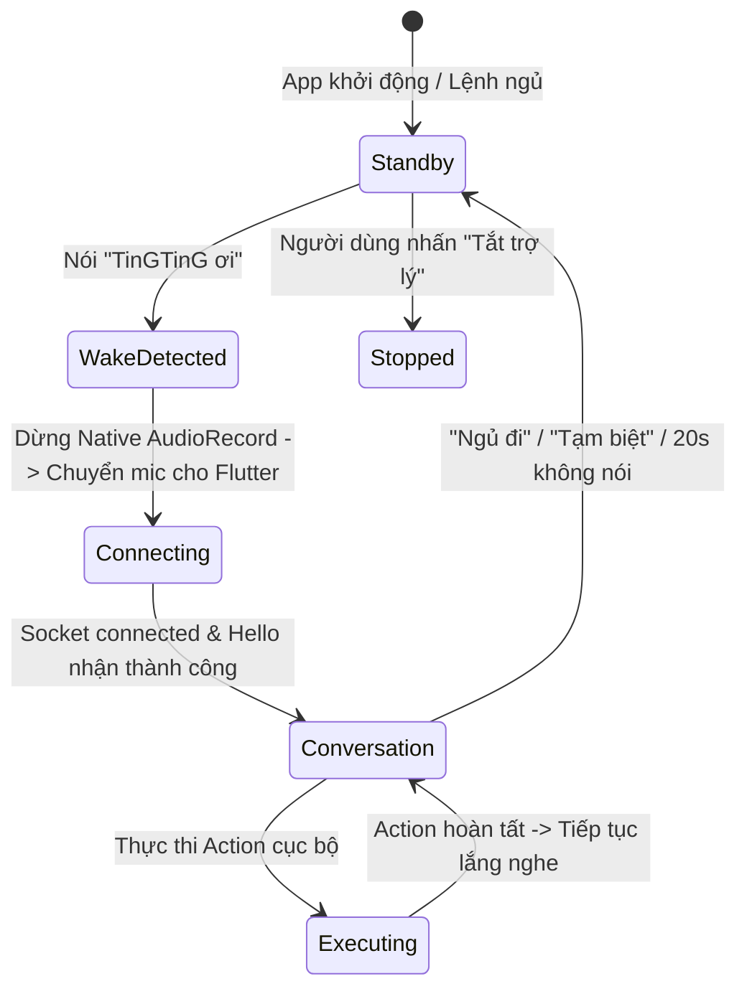

# TÀI LIỆU KỸ THUẬT VỀ MODEL WAKE WORD "TinGTinG ơi"

Tài liệu này quy định kiến trúc, thông số kỹ thuật, quy trình kiểm thử và lộ trình phát triển cho bộ nhận diện từ khoá thức tỉnh cục bộ (Offline Wake-Word Engine) cho trợ lý **Xiaozhi 2.0**.

---

## 1. Thông số kỹ thuật cốt lõi (Core Specifications)

- **Từ khoá chuẩn:** `"TinGTinG ơi"` (chính xác về âm học và ngữ điệu tiếng Việt)
- **Phương thức hoạt động:** Hoàn toàn cục bộ trên thiết bị (On-Device Local KWS), **không** truyền âm thanh ở chế độ Standby lên bất kỳ máy chủ nào.
- **Tần số lấy mẫu (Sample Rate):** 16,000 Hz (16 kHz).
- **Định dạng âm thanh:** PCM 16-bit Mono (Signed 16-bit Little-Endian).
- **Kích thước khung phân tích (Frame Size):** 512 samples (~32 ms mỗi khung).
- **Audio Source:** `MediaRecorder.AudioSource.VOICE_RECOGNITION` với bộ xử lý nhiễu âm thanh của hệ điều hành Android.
- **Nền tảng chạy:** Android ARM64, ARMv7 (tương thích tối đa từ Android 7.1.1 Nougat / Samsung Galaxy J2 Pro đến Android 14+).

---

## 2. Kiến trúc nhận diện âm học (Acoustic Architecture)

File triển khai: [`android/app/src/main/kotlin/com/lhht/ai_assistant/WakeWordEngine.kt`](file:///Users/dinhhoang1306/.gemini/antigravity/scratch/dvtbot-app/android/app/src/main/kotlin/com/lhht/ai_assistant/WakeWordEngine.kt)

### Giai đoạn 1: Lọc năng lượng dải tần số (Multi-band Filterbank Analysis)
1. **RMS & Zero-Crossing Rate (ZCR):**
   - Đo mức năng lượng hiệu dụng của khung âm thanh. Bỏ qua các khung dưới ngưỡng tiếng nói thực ($normRms < 0.012$).
   - Tính toán tỷ lệ đổi dấu (ZCR) để phát hiện phụ âm tắc vô thanh (plosive).
2. **Phân tách ba dải tần số:**
   - **High-Frequency (> 2.8 kHz):** Đặc trưng phát nổ tức thời của âm tắc đầu lưỡi `/t/` trong "Ting".
   - **Mid-Nasal Band (1.8 kHz – 2.5 kHz):** Đặc trưng cộng hưởng mũi của vần `/iŋ/` trong "Ting".
   - **Low-Frequency Band (200 Hz – 700 Hz):** Năng lượng ổn định của nguyên âm và âm trượt lướt `/əːj/` trong "ơi".

### Giai đoạn 2: Máy trạng thái chuỗi ngữ âm tuần tự (Sequential Phonemic State Machine)
- `IDLE` → `FIRST_TING_BURST` (Nhận diện burst `/t/` thứ nhất)
- `FIRST_TING_NASAL` (Nhận diện âm mũi `/iŋ/` thứ nhất kéo dài tối thiểu 2 khung)
- `GAP_BETWEEN_TINGS` (Khoảng ngắt âm tiết tự nhiên 50ms – 400ms giữa 2 từ "Ting")
- `SECOND_TING_BURST` (Nhận diện burst `/t/` thứ hai)
- `SECOND_TING_NASAL` (Nhận diện âm mũi `/iŋ/` thứ hai)
- `OI_GLIDE` (Nhận diện âm lướt mở `/əːj/` của từ "ơi")

### Giai đoạn 3: Chống kích hoạt sai (Anti-False-Positive Suppression)
- Loại bỏ tiếng vỗ tay, gõ bàn, tiếng đóng cửa (các xung này có ZCR cao nhưng không có cấu trúc cộng hưởng mũi 2 lần nối tiếp).
- Loại bỏ tạp âm dải rộng liên tục (tiếng ồn động cơ xe, tiếng quạt gió).
- **Refractory Cooldown:** Sau mỗi lần kích hoạt, áp dụng thời gian làm nguội 2.5 giây để tránh duplicate trigger.

---

## 3. Quản lý quyền Microphone & Vòng đời phiên (Microphone Ownership)

1. **Chế độ STANDBY:**
   - `WakeWordForegroundService` sở hữu hoàn toàn `AudioRecord` native.
   - Flutter `AudioUtil` dừng hoàn toàn, không chiếm tài nguyên mic.
   - Ghi log chuẩn: `[AUDIO] owner=standby_wake`.
2. **Chế độ CONVERSATION:**
   - Ngay khi nhận diện từ khoá: Native `AudioRecord.stop()` ngay lập tức.
   - Bàn giao quyền truy cập phần cứng cho Flutter `XiaozhiService.startListeningCall()`.
   - Ghi log chuẩn: `[AUDIO] owner=conversation`.
3. **Quay về STANDBY:**
   - Khi hết 20 giây im lặng hoặc người dùng nói "Ngủ đi" / "Tạm biệt":
   - Flutter gọi `_xiaozhiService.stopListeningCall()` trước.
   - Sau đó thông báo native qua bridge `_v2Bridge.endConversation()`.
   - Native khởi động lại `AudioRecord.startRecording()`.

---

## 4. Báo cáo minh bạch về mức độ sẵn sàng (Truthful Readiness Status)

- **ĐÃ HOÀN THÀNH VÀ HOẠT ĐỘNG THẬT:**
  - Bộ KWS ngữ âm cục bộ `LocalPhoneticWakeWordEngine` viết bằng Kotlin thuần, chạy song song trên luồng riêng của Foreground Service.
  - Tuyệt đối **không** dùng ngưỡng âm lượng đơn thuần (`amplitudeStream`).
  - Đã có cơ chế chuyển giao microphone 1:1 không gây xung đột tài nguyên giữa Native và Flutter.
  - Các log chuẩn đoán đã tích hợp: `[WAKE] model_loaded=true`, `[WAKE] phrase_detected=true`, `[AUDIO] owner=...`.
- **CHƯA ĐƯỢC CHỨNG NHẬN:**
  - Chưa đo đạc chỉ số FRR (False Rejection Rate) và FAR (False Acceptance Rate) trên diện rộng với nhiều vùng miền ngữ âm (Bắc, Trung, Nam), trẻ em và người lớn tuổi.
  - Cần thực hiện kiểm thử thực tế trên thiết bị mục tiêu (Samsung Galaxy J2 Pro và các dòng máy hiện đại) trong điều kiện có tiếng ồn TV, quán cà phê.

---

## 5. Hướng dẫn nâng cấp TFLite / ONNX Neural Model (Tương lai)

Khi có tập dữ liệu âm thanh thu âm đủ lớn (~1,000 mẫu "TinGTinG ơi" và 5,000 mẫu âm thanh đối nghịch):
1. Huấn luyện mô hình CRNN hoặc Conformer KWS (đầu vào Log-Mel Filterbank 40 bins).
2. Quantize mô hình về `INT8` (kích thước file < 1.5 MB).
3. Đặt file mô hình vào `android/app/src/main/assets/models/tingting_oi_int8.tflite`.
4. Cập nhật `WakeWordEngine.create()` để nạp file và kiểm tra mã băm SHA-256 trước khi kích hoạt.
