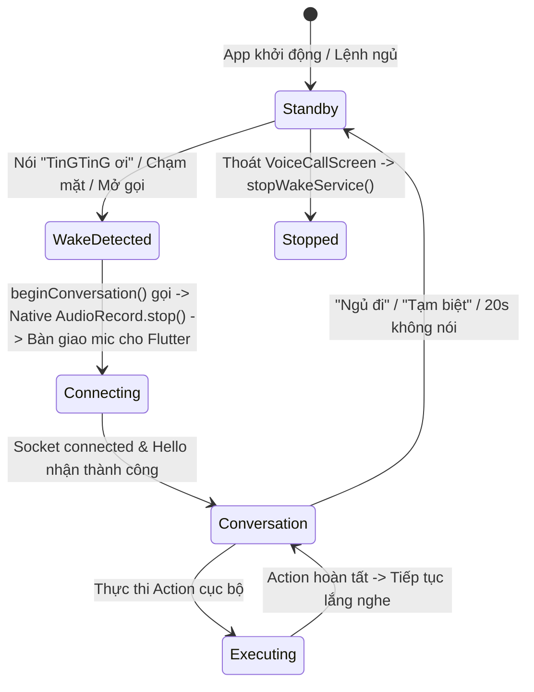

# TÀI LIỆU KỸ THUẬT VỀ MODEL WAKE WORD "TinGTinG ơi"

Tài liệu này quy định kiến trúc, thông số kỹ thuật, quy trình kiểm thử và lộ trình phát triển cho bộ nhận diện từ khoá thức tỉnh cục bộ (Offline Wake-Word Engine) cho trợ lý **Xiaozhi 2.0**.

---

## 1. Thông số kỹ thuật cốt lõi (Core Specifications)

- **Từ khoá chuẩn:** `"TinGTinG ơi"` (chính xác về âm học và ngữ điệu tiếng Việt)
- **Phương thức hoạt động:** Hoàn toàn cục bộ trên thiết bị (On-Device Local KWS), **không** truyền âm thanh ở chế độ Standby lên bất kỳ máy chủ nào.
- **Tần số lấy mẫu (Sample Rate):** 16,000 Hz (16 kHz).
- **Định dạng âm thanh:** PCM 16-bit Mono (Signed 16-bit Little-Endian).
- **Kích thước khung phân tích (Frame Size):** 320–512 samples (20–32 ms mỗi khung).
- **Audio Source:** `MediaRecorder.AudioSource.VOICE_RECOGNITION` với bộ xử lý nhiễu âm thanh của hệ điều hành Android.
- **Nền tảng chạy:** Android ARM64, ARMv7 (tương thích tối đa từ Android 7.1.1 Nougat / Samsung Galaxy J2 Pro đến Android 14+).

---

## 2. Kiến trúc nhận diện âm học (Acoustic Architecture)

File triển khai: [`android/app/src/main/kotlin/com/lhht/ai_assistant/WakeWordEngine.kt`](file:///Users/dinhhoang1306/.gemini/antigravity/scratch/dvtbot-app/android/app/src/main/kotlin/com/lhht/ai_assistant/WakeWordEngine.kt)

### Giai đoạn 1: Bộ lọc Biquad IIR Filterbank chuẩn (Multi-band Filterbank Analysis)
Bộ lọc nhị thứ (Biquad IIR) chuẩn Direct Form II hoạt động ở tần số lấy mẫu 16 kHz:
1. **High-Pass Biquad (> 3.0 kHz):**
   - Hệ số: $b_0=0.41816, b_1=-0.83632, b_2=0.41816, a_1=-0.46294, a_2=0.20971$.
   - Bắt đặc trưng phát nổ tức thời của âm tắc đầu lưỡi `/t/` trong "Ting".
2. **Band-Pass Biquad (1.6 kHz – 2.6 kHz, tần số tâm 2.1 kHz, Q=1.8):**
   - Hệ số: $b_0=0.16943, b_1=0.0, b_2=-0.16943, a_1=-1.12747, a_2=0.66114$.
   - Tách chính xác vùng formant cộng hưởng mũi của vần `/iŋ/` trong "Ting".
3. **Low-Pass Biquad (200 Hz – 800 Hz):**
   - Hệ số: $b_0=0.02008, b_1=0.04016, b_2=0.02008, a_1=-1.56101, a_2=0.64135$.
   - Lọc năng lượng của nguyên âm và âm trượt lướt `/əːj/` trong "ơi".
4. **RMS & Zero-Crossing Rate (ZCR):**
   - Ngưỡng tiếng nói thực $normRms \ge 0.012$.
   - ZCR đo tần suất đổi dấu để phân biệt phụ âm vô thanh và nguyên âm hữu thanh.

### Giai đoạn 2: Máy trạng thái chuỗi ngữ âm tuần tự (Sequential Phonemic State Machine)
- `IDLE` → `FIRST_TING_BURST`: Nhận diện burst `/t/` thứ nhất.
- `FIRST_TING_NASAL`: Nhận diện âm mũi `/iŋ/` thứ nhất (tối thiểu 2 khung liên tiếp).
- `GAP_BETWEEN_TINGS`: **Bắt buộc có khoảng ngắt âm tiết tự nhiên 50ms – 400ms giữa 2 từ "Ting"**.
  - Nếu âm mũi `/iŋ/` kéo dài liên tục không ngắt trong < 50ms, máy trạng thái không chuyển sang tiếng thứ 2 mà đặt lại mốc thời gian, loại bỏ hoàn toàn việc nhầm lẫn một âm ngân dài thành 2 tiếng.
  - Nếu quá 400ms không có âm tiết tiếp theo: tự động reset về `IDLE`.
- `SECOND_TING_BURST` → `SECOND_TING_NASAL`: Nhận diện tiếng "Ting" thứ hai.
- `OI_GLIDE`: Nhận diện âm lướt mở `/əːj/` của từ "ơi".

### Giai đoạn 3: Chống kích hoạt sai (Anti-False-Positive Suppression)
- Loại bỏ tiếng vỗ tay, gõ bàn, tiếng đóng cửa (xung ZCR cao nhưng không có cấu trúc cộng hưởng mũi 2 lần phân cách).
- Loại bỏ tạp âm dải rộng liên tục (tiếng quạt, tiếng TV mono).
- **Refractory Cooldown:** 2.5 giây làm nguội sau mỗi lần kích hoạt để tránh duplicate trigger.

---

## 3. Quản lý quyền Microphone & Vòng đời phiên (Microphone Ownership 1:1)

1. **Chế độ STANDBY:**
   - `WakeWordForegroundService` sở hữu hoàn toàn `AudioRecord` native.
   - Flutter `AudioUtil` dừng hoàn toàn, không chiếm tài nguyên mic.
   - Ghi log chuẩn: `[AUDIO] owner=standby_wake`.
2. **Bàn giao quyền Microphone (beginConversation):**
   - Áp dụng đồng nhất cho cả 3 đường dẫn đánh thức:
     1. Nhận diện từ khoá "TinGTinG ơi" từ native.
     2. Chạm vào khuôn mặt robot trên màn hình.
     3. Khởi động màn hình thoại ban đầu (`_connectToVoiceService`).
   - Lệnh `beginConversation()` đặt cờ `AtomicBoolean conversationActive = true` và gọi ngay `AudioRecord.stop()`.
   - Sau đó Flutter mới bắt đầu ghi âm `AudioUtil.startRecording()`.
   - Ghi log chuẩn: `[AUDIO] owner=conversation`.
3. **Quay về STANDBY (endConversation):**
   - Khi hết 20 giây im lặng hoặc người dùng nói "Ngủ đi" / "Tạm biệt":
   - Flutter gọi `_xiaozhiService.stopListeningCall()` trước.
   - Sau đó thông báo native qua bridge `_v2Bridge.endConversation()`.
   - Native khởi động lại `AudioRecord.startRecording()`.
4. **Quản lý quyền RECORD_AUDIO:**
   - Trước khi gọi `startWakeService()`, app kiểm tra và yêu cầu quyền `RECORD_AUDIO` qua `permission_handler`.
   - Khi rời khỏi màn hình (`dispose()`), app gọi `_v2Bridge.stopWakeService()` để giải phóng hoàn toàn dịch vụ chạy nền.

---

## 4. Báo cáo minh bạch về mức độ sẵn sàng (Truthful Readiness Status)

- **PHÂN LOẠI CÔNG NGHỆ HIỆN TẠI:**
  - Bộ nhận diện từ khoá là thuật toán **DSP ngữ âm heuristic đa dải tần số** (`dsp_phonetic_heuristic`), **chưa phải mô hình học máy (neural network)**.
  - Log khởi động thể hiện chính xác: `[WAKE] engine=dsp_phonetic_heuristic status=ready`.
  - Log khi kích hoạt từ khoá: `[WAKE] phrase_detected=true`.
- **ĐÃ HOÀN THÀNH VÀ HOẠT ĐỘNG THẬT:**
  - Bộ lọc Biquad IIR đa băng thông (HP >3kHz, BP 1.6-2.6kHz, LP 200-800Hz) chuẩn hóa Direct Form II.
  - Máy trạng thái ngữ âm 3 giai đoạn có cưỡng bức khoảng ngắt tối thiểu 50ms – 400ms giữa 2 tiếng "Ting".
  - Chuyển giao microphone 1:1 đa luồng an toàn bằng `AtomicBoolean` và lệnh native `beginConversation()`.
  - Kiểm thử âm học đơn vị (Unit Tests) với các khung âm thanh tổng hợp: năng lượng im lặng, tiếng ồn ngẫu nhiên và âm mũi liên tục không ngắt.
- **LỘ TRÌNH TÍCH HỢP NEURAL MODEL (Tương lai):**
  - Khi có tập dữ liệu thu âm thực tế (~1,000 mẫu "TinGTinG ơi" và 5,000 mẫu âm thanh đối nghịch):
  - 1. Huấn luyện mô hình CRNN hoặc Conformer KWS (đầu vào Log-Mel Filterbank 40 bins).
  - 2. Quantize mô hình về `INT8` (kích thước file < 1.5 MB).
  - 3. Đặt file mô hình vào `android/app/src/main/assets/models/tingting_oi_int8.tflite`.
  - 4. Cập nhật `WakeWordEngine.create()` để nạp file và kiểm tra mã băm SHA-256 trước khi kích hoạt.
